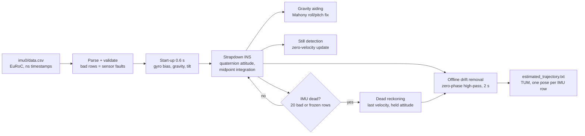
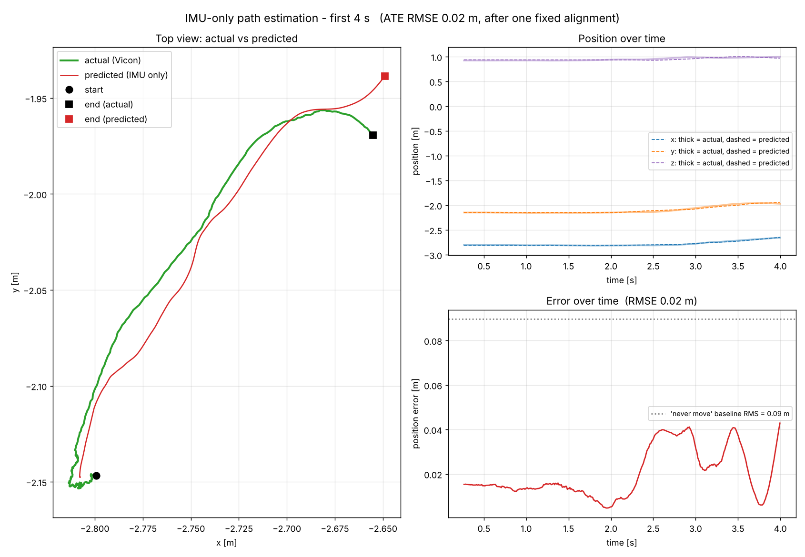
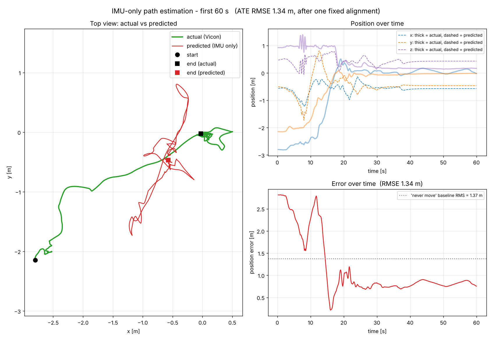
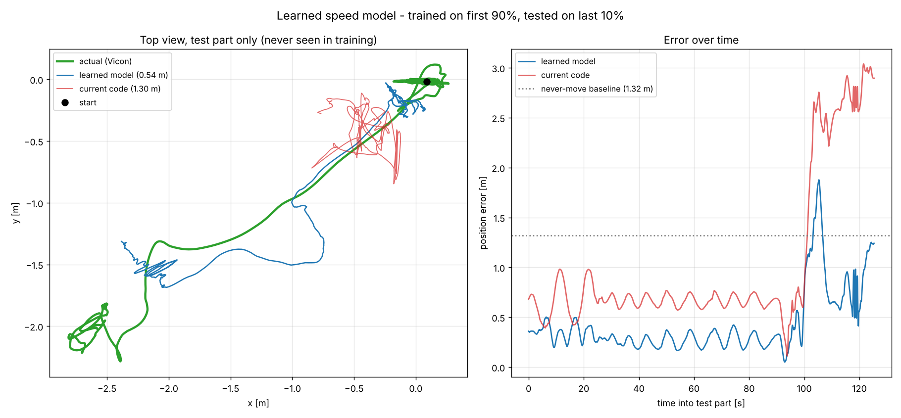
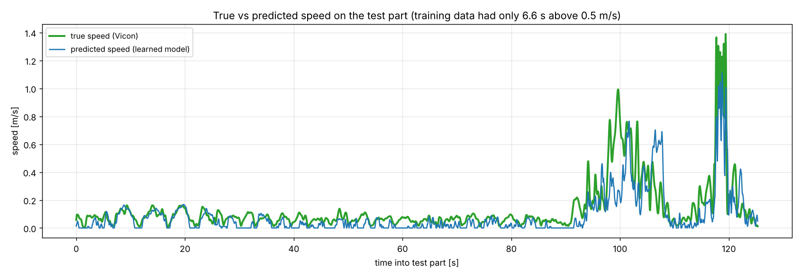

# Path Finder: Trajectory Estimation Under Sensor Degradation

Last updated: 2026-11-22 05:41 PM IST

**Samsung XR Hackathon 2026, Track 03.** Team **Trinity Stack**, Thapar Institute of Engineering and
Technology (TIET): Aashiya Ahuja, Naman Garg, Naman Narang.

We estimate a 6-DoF trajectory (position + orientation)
from a degrading IMU alone, keep going when frames drop, and dead-reckon for 5 seconds after the
IMU dies, within 8 MB of peak RAM and 20 ms of compute per second of IMU data on one CPU thread.

| | Result | Limit |
|---|---|---|
| Peak memory (C++, 21-minute recording) | **2.08 MB** | 8 MB |
| Compute | **0.84 ms per 1 s of IMU** | 20 ms |
| Output | **255,029 poses for 255,029 IMU rows** | exactly one per row |
| Short-term accuracy (first 4 s vs Vicon) | **2.3 cm** | |
| IMU-failure handling | NaN, zero, frozen and dropped frames all detected | |

## Contents

- [Submission checklist](#submission-checklist)
- [The problem](#the-problem)
- [How it works](#how-it-works)
- [Results](#results)
- [Quick start](#quick-start)
- [Repository layout](#repository-layout)
- [Tests and quality checks](#tests-and-quality-checks)
- [Limitations](#limitations)
- [Troubleshooting](#troubleshooting)

## Submission checklist

| Item | Where |
|---|---|
| Submission package (Track 03 bundle) | [`submission/`](submission): `estimated_trajectory.txt`, `metadata.json`; `make bundle` builds `TIET_TrinityStack.zip` with `src/` |
| Source code | [`src/main.cpp`](src/main.cpp) (contest entry point), [`src/main.py`](src/main.py) (standalone Python script), demo and model code in [`src/`](src) |
| Presentation | [`presentation/`](presentation) |
| Video (pipeline walkthrough, max 3 min) | [`video/README.md`](video/README.md) |
| AI disclosure | [`AI_DISCLOSURE.md`](AI_DISCLOSURE.md) |
| README | this file; build and run details in [`src/README.md`](src/README.md) |
| Docker | [`Dockerfile`](Dockerfile) |
| APK / SDK | not applicable: an offline command-line tool, not a mobile app or library (build the binary with `make build`) |

<sub>[↑ Back to contents](#contents)</sub>

## The problem

An aircraft flies through waypoints with no GPS. Jamming makes its IMU progressively worse:
more noise, drifting bias, dropped frames, and finally total failure. From the IMU readings alone
we must estimate where it was and how it was oriented at every sample, then predict the last
5 seconds after the IMU dies. Integrating acceleration twice turns every small sensor error into a
position error that grows with the square of time, so the hard part is keeping that drift bounded
while staying inside a tiny memory and compute budget.

<sub>[↑ Back to contents](#contents)</sub>

## How it works



1. **Streaming input.** One row in, one pose out; memory stays constant. Dropped frames are
   bridged by sub-stepping with interpolated readings, using the real timestamps.
2. **Orientation.** Gyro integration on quaternions, corrected toward gravity whenever the
   accelerometer reads close to 1 g, which keeps roll and pitch within 1–2°.
3. **Zero-velocity updates.** When the sensor looks still, velocity is reset and the gyro bias is
   refined. The stillness thresholds come from the start-up noise level, so a noisy sensor
   switches ZUPT off by itself.
4. **Failure detection.** NaN/empty/zeroed/absurd readings and runs of bit-identical (frozen)
   readings are detected; after 20 in a row the IMU is declared dead and the estimator coasts
   from its last good state (the blind 5 s).
5. **Offline drift removal.** The task is offline, so a second pass removes slow drift with a
   zero-phase high-pass filter. The C++ version stores the low-pass every 0.1 s, so the extra
   memory stays small (2.1 MB for 21 minutes).

**Research extension (not used in the contest submission):** [`src/train_and_test.py`](src/train_and_test.py)
learns speed from IMU patterns with a small neural network, using Vicon as the teacher, trained
on the first 90 % of a recording and scored on the unseen last 10 %.

<sub>[↑ Back to contents](#contents)</sub>

## Results

Measured on the supplied phone IMU recording (200 Hz, 21 minutes) with Vicon motion capture as
ground truth. Error is position RMSE after one rigid alignment, as `evo_ape -a` computes it.

| Window | Our estimate | A path that never moves |
|---|---|---|
| First 4 s (raw dead reckoning) | **0.023 m** | 0.090 m |
| First 60 s (with drift removal) | 1.34 m | 1.37 m |
| Whole 21 min (C++ submission file) | 0.585 m | 0.577 m |

| Learned speed model, last 10 % (unseen) | Learned | Plain estimator | Never moves |
|---|---|---|---|
| Whole 125 s | **0.54 m** | 1.30 m | 1.32 m |
| 30 s windows | **0.22 m** | 0.42 m | 0.45 m |

| First 4 s: actual vs predicted | First 60 s: drift |
|---|---|
|  |  |
| **Learned model on unseen data** | **Why it still misses the fast walk** |
|  |  |

**Reading these honestly.** Over a few seconds the estimate is accurate to centimetres. Over
minutes, a phone accelerometer drifts too much for IMU-only position: the long-window error is
no better than a path that never moves. Feeding Vicon's perfect orientation into the same
integration still drifts about 2 m in 10 s, so the limit is the accelerometer, not the attitude
filter. The learned model halves the error on unseen data but needs Vicon to train, so it is a
research result, not part of the IMU-only submission. These numbers come from one phone
recording; we could not test on EuRoC MAV or TUM-VI.

<sub>[↑ Back to contents](#contents)</sub>

## Quick start

**C++ (the contest entry point):**

```bash
make build
./build/pathfinder imu0/data.csv estimated_trajectory.txt --report   # --report prints peak memory
```

**Python (standalone script, same algorithm):**

```bash
pip install -r requirements.txt
python src/main.py imu0/data.csv estimated_trajectory.txt
```

**Docker:**

```bash
docker build -t pathfinder .
docker run --rm -v "$PWD/my_sequence:/data" -v "$PWD/out:/out" pathfinder
# my_sequence/imu0/data.csv  ->  out/estimated_trajectory.txt
```

**Graphs (actual vs predicted, needs a Vicon file):**

```bash
python src/graph_4s.py data/gyro_accel.csv --vicon data/vicon_capture_quaternion.csv          # output_4s/paths.png
python src/demo_python.py data/gyro_accel.csv --vicon data/vicon_capture_quaternion.csv --secs 60
python src/train_and_test.py data/gyro_accel.csv --vicon data/vicon_capture_quaternion.csv    # learned model, ~1 min
bash scripts/make_figures.sh                                                                  # regenerate docs/figures
```

**Submission zip:** `make bundle` writes `TIET_TrinityStack.zip`
with `estimated_trajectory.txt`, `metadata.json` and `src/`.

Options for every script: `--help`. Details: [`src/README.md`](src/README.md).

<sub>[↑ Back to contents](#contents)</sub>

## Repository layout

| Path | Contents |
|---|---|
| `src/main.cpp` | C++17 estimator, single file, no dependencies |
| `src/main.py` | standalone Python entry point (same algorithm) |
| `src/demo_python.py` | Python estimator + Vicon sync + CLI that draws the comparison graph |
| `src/plot_paths.py` | alignment, error metrics, plotting |
| `src/graph_4s.py` | one-click 4-second graph |
| `src/train_and_test.py` | learned speed model, train / test split |
| `submission/` | `estimated_trajectory.txt` and `metadata.json` for the supplied recording |
| `data/` | supplied IMU and Vicon recordings ([`data/README.md`](data/README.md)) |
| `docs/figures/` | the four figures above, regenerated by `scripts/make_figures.sh` |
| `tests/` | 62 automated tests with golden fixtures, plus an optional real-data test |
| `tools/` | development and evaluation scripts (simulator, degradation, evo helpers); quick research code, excluded from the lint gate |
| `presentation/`, `video/` | deck and demo-video link |

<sub>[↑ Back to contents](#contents)</sub>

## Tests and quality checks

```bash
pip install -r requirements-dev.txt
make test     # 62 Python tests + a C++ one-pose-per-row smoke test
make lint     # ruff, mypy --strict, bandit
python -m pip_audit -r requirements.txt
```

The same checks run in GitHub Actions on every push ([`.github/workflows/ci.yml`](.github/workflows/ci.yml)).
The C++ and Python estimators agree on every pose to the last printed digit except 8 of 255,029
quaternions that differ by 1e-9 (rounding). With drift removal the C++ version, which stores the
drift every 0.1 s to save memory, differs from Python by at most 4.7 cm.

<sub>[↑ Back to contents](#contents)</sub>

## Limitations

- IMU-only position drifts; drift removal bounds it by assuming the device stays in a bounded
  area. Use `--no-smooth` for long trips.
- Tuned on one phone recording and a synthetic simulator; not tested on EuRoC MAV, TUM-VI or the
  organisers' degradation script.
- The output frame starts at the origin with yaw 0, so scoring needs alignment (`evo_ape -a`).
- The learned model needs Vicon to train and learns one phone; it cannot be submitted for
  IMU-only Track 03.
- The Docker image was written but not built in our development environment.

<sub>[↑ Back to contents](#contents)</sub>

## Troubleshooting

| Problem | Fix |
|---|---|
| `g++: command not found` | Windows: MSYS2 `pacman -S mingw-w64-ucrt-x86_64-gcc`; macOS: `xcode-select --install`; Linux: `sudo apt install g++` |
| `No module named numpy` / `sklearn` | `pip install -r requirements.txt` |
| `Cannot find the IMU file` | give the full path, or run from the repository root |
| Output has fewer rows than the input | rows without a numeric timestamp are skipped as headers; every timestamped row gets a pose |
| `Vicon/IMU sync is weak` | the two files are from different recordings, or set `--vicon-hz` |

<sub>[↑ Back to contents](#contents)</sub>
